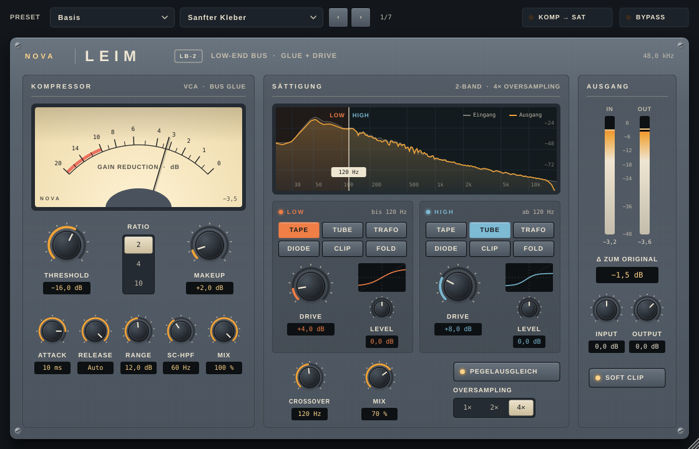

# NOVA LEIM

**Low-End-Bus-Prozessor für Kick und Bass**: ein Glue-artiger VCA-Kompressor und eine 2-Band-Sättigung in einem Plugin.



Formate: **VST3, AU und Standalone auf macOS** (Universal: Apple Silicon und Intel) sowie **VST3 und Standalone auf Windows** (x64).

---

## Funktionen

**Kompressor (VCA, Bus Glue)**
- Threshold, Ratio 2/4/10, Makeup
- Attack in Glue-Stufen: 0,01 / 0,1 / 0,3 / 1 / 3 / 10 / 30 ms
- Release: 0,1 bis 1,2 s oder Auto (Programmabhängig, zwei Zeitkonstanten)
- Range begrenzt die maximale Gain Reduction
- Sidechain-Hochpass (30 bis 300 Hz), damit Sub-Energie den Bus nicht pumpen lässt
- Dry/Wet für Parallelkompression
- Gain-Reduction-Nadel

**Sättigung (2-Band)**
- Linkwitz-Riley-Weiche mit 24 dB/Okt, Crossover 40 bis 400 Hz (auch im Spektrum ziehbar)
- Pro Band: sechs Kennlinien (Tape, Tube, Trafo, Diode, Clip, Fold), Drive, Level
- Pegelausgleich, 1×/2×/4× Oversampling
- Dry/Wet bleibt phasengleich, weil das trockene Signal dieselbe Weiche durchläuft

**Ausgang**
- Input, Output, Soft Clip, Reihenfolge Komp → Sat oder Sat → Komp
- Ein-/Ausgangspegel und „Δ zum Original“ für fairen A/B-Vergleich
- Interner Bypass mit Überblendung

**Presets:** 103 Presets in 9 Gruppen. Neben „Basis“ gibt es Techno, Hard Techno, Soft & Clean, House, Tech House, Melodic & Progressive, Drum & Bass und Hip-Hop & Trap mit je 12 Presets. Sie erscheinen im Plugin-Browser und in der Programmliste des Hosts.

---

## Fertige Builds herunterladen

Jeder Push auf `main` baut das Plugin automatisch über GitHub Actions:

1. Im Repository auf **Actions** gehen und den letzten erfolgreichen Lauf von **Build** öffnen.
2. Unten unter **Artifacts** `NOVA-LEIM-macOS` oder `NOVA-LEIM-Windows` herunterladen.

Für ein Release mit Download-Seite einen Versions-Tag pushen:

```bash
git tag v0.1.0
git push origin v0.1.0
```

Danach liegen beide ZIP-Dateien unter **Releases**.

## Installation

| System  | Format     | Ordner |
|---------|------------|--------|
| macOS   | VST3       | `~/Library/Audio/Plug-Ins/VST3/` |
| macOS   | AU         | `~/Library/Audio/Plug-Ins/Components/` |
| macOS   | Standalone | `/Programme` |
| Windows | VST3       | `C:\Program Files\Common Files\VST3\` |
| Windows | Standalone | beliebig |

Danach in der DAW nach neuen Plugins suchen lassen (Ableton: *Einstellungen → Plug-Ins → Neu scannen*).

**macOS-Hinweis:** Die automatischen Builds sind nur ad-hoc signiert, nicht notarisiert. Wenn macOS das Plugin blockiert, einmal im Terminal ausführen:

```bash
xattr -dr com.apple.quarantine ~/Library/Audio/Plug-Ins/VST3/LEIM.vst3
xattr -dr com.apple.quarantine ~/Library/Audio/Plug-Ins/Components/LEIM.component
```

**Windows-Hinweis:** SmartScreen kann bei der Standalone-App warnen, weil sie nicht signiert ist. Über *Weitere Informationen → Trotzdem ausführen* starten.

---

## Selbst bauen

Voraussetzungen:
- [CMake](https://cmake.org/download/) 3.22 oder neuer und Git
- **macOS:** Xcode 15 oder neuer
- **Windows:** Visual Studio 2022 mit der Workload „Desktopentwicklung mit C++“

JUCE wird beim Konfigurieren automatisch heruntergeladen (Version in `CMakeLists.txt`, Variable `LEIM_JUCE_TAG`).

**macOS**

```bash
cmake -B build -G Xcode -DCMAKE_OSX_ARCHITECTURES="arm64;x86_64"
cmake --build build --config Release
```

**Windows** (in der „Developer PowerShell for VS 2022“)

```powershell
cmake -B build -G "Visual Studio 17 2022" -A x64
cmake --build build --config Release
```

Die fertigen Plugins liegen danach in `build/NovaLeim_artefacts/Release/`.

Zum Entwickeln einfach `build/NovaLeim.xcodeproj` bzw. `build/NovaLeim.sln` öffnen. Die Standalone-App eignet sich gut zum schnellen Testen ohne DAW.

DSP-Tests laufen mit:

```bash
ctest --test-dir build -C Release --output-on-failure
```

---

## Auf GitHub hochladen

```bash
cd nova-leim
git init
git add .
git commit -m "NOVA LEIM: erster Stand"
git branch -M main
git remote add origin https://github.com/DEIN-NAME/nova-leim.git
git push -u origin main
```

Der Workflow in `.github/workflows/build.yml` startet automatisch.

---

## Projektstruktur

```
CMakeLists.txt              Build-Konfiguration (JUCE wird automatisch geladen)
Source/
  dsp/LeimDSP.h             DSP-Kern ohne JUCE: Kompressor, Weiche, Kennlinien, Oversampling
  Presets.h                 103 Presets
  Parameters.h/.cpp         Parameter, Wertebereiche, Anzeigeformate
  PluginProcessor.h/.cpp    Audio-Verarbeitung, Presets, State speichern/laden
  PluginEditor.h/.cpp       Oberfläche (skalierbar)
  ui/                       Look & Feel, Regler, Meter, Spektrum
tests/dsp_test.cpp          DSP-Tests (laufen in CI)
prototype/index.html        Web-Prototyp zum Ausprobieren im Browser
.github/workflows/build.yml Automatische Builds für macOS und Windows
```

## Signal-Fluss

```
Input → Kompressor → Sättigung (Low | High) → Output → Soft Clip
        (Reihenfolge Kompressor/Sättigung umschaltbar)
```

---

## Für ein kommerzielles Release

- **Signierung:** macOS braucht ein Apple-Developer-Zertifikat und Notarisierung, Windows idealerweise ein Code-Signing-Zertifikat.
- **AAX (Pro Tools):** braucht das AAX-SDK von Avid und eine PACE-Signierung.
- **Lizenz:** JUCE steht unter AGPLv3 oder einer kommerziellen JUCE-Lizenz. Prüfe vor dem Verkauf, welche Lizenz für dich passt, und lege eine eigene `LICENSE`-Datei an.
